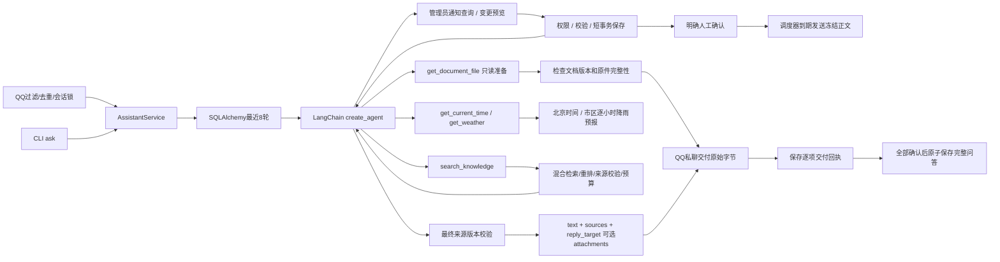

# Agent 请求流程

QQ 完成过滤、去重和会话锁后，由入口绑定真实身份、消息ID与接收时间。只有精确人工命令由通知服务直接处理；自然语言统一进入同一个 Agent，由它选择知识检索、文件、时间、天气或管理员通知查询/预览工具。CLI 无通知权限。通知确认不经过模型，到期发送由独立调度器执行。详见 [统一 Agent 说明](UNIFIED_AGENT.md)。

定位：agent/factory.py 构建 Agent；agent/tools.py 提供检索，agent/files.py 提供文件准备；service.py 分离 prepare_response 与 commit_turn。agent/notifications.py 封装绑定身份的通知工具，agent/context.py 保存可信请求上下文。没有 agent.graph 文件，底层执行由 LangChain 管理。

Agent 识别文件意图，通过只读工具准备附件；服务按明确标题、登记别名或纯指代的同会话来源 ID 校验。未知明确名称不回退历史，否定请求阻止附件，多候选要求澄清。原件字节不进入模型上下文。QQ 成功交付后才提交历史；CLI 不发送附件。详见 FILE_DELIVERY.md。

请求最多八次工具调用、十次模型调用；工具串行。最终无证据、检索异常、模型异常或超限时返回说明，不进入完整问答保存。资料是模型输入数据，提示词要求忽略资料中的指令并按来源回答。

通知管理回复统一私聊，目标随回答快照持久化；生成预览优先交付服务端固定文本。普通查询可保存管理员本人完整问答，不为通知接收者写聊天记录。草稿落盘后模型失败仍返回原始预览，任务保持未确认。

当前群入口全局静默：任何群消息均不进入问答或确认命令链路。来源群按确认规则收集固定60秒窗口，管理员私聊要求生成预览并确认版本后，由独立工作器发布。统一 Agent 新增 query_group_forwarding、prepare_group_forwarding、control_group_forwarding，仅真实QQ管理员获得；模型没有确认或发送工具。新增四张群转发表，迁移版本7，新库16表；通知调度不变。详细交互、原生转发限制及失败恢复见 [群转发说明](GROUP_FORWARDING.md)。
