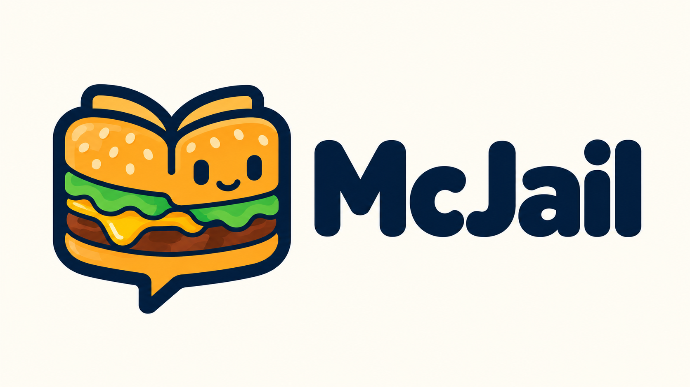

# McJail



> An AI-powered campus assistant for QQ, independently developed by TenStar.

## About

McJail helps students find school policies, understand notices, and get the documents they need. It brings knowledge retrieval, original document delivery, scheduled notifications, and administrator-reviewed group forwarding into everyday QQ conversations.

The project is independently designed, developed, and maintained by [TenStar](https://github.com/TenStarFengPiao).

## Visual Identity

The landscape banner places the mascot on the left and the McJail wordmark on the right. The mascot combines a sesame-seed hamburger, an open book, and a smiling chat bubble.

| Element | Meaning |
| --- | --- |
| Hamburger | A playful and recognizable project identity |
| Open book | Campus knowledge, policies, and documents |
| Chat bubble | Assistance through conversation |
| Smile | A friendly, approachable assistant |

Golden yellow and dark navy provide the main contrast, with lettuce green and patty brown completing the hamburger motif. A warm ivory background keeps the banner easy to read.

The current English-only banner is [assets/mcjail-banner-en.png](../assets/mcjail-banner-en.png). It was edited with the built-in imagegen tool. Keep its original proportions when displaying it.

## Banner Editing Prompt

```text
Edit the provided McJail banner. Remove ALL Chinese characters and remove the smaller subtitle under the wordmark. The ONLY visible text in the final image must be exactly 'McJail'. Preserve the existing hamburger/open-book/chat-bubble mascot, its sesame bun, lettuce, cheese, patty, friendly face, navy outlines, colors, warm ivory background and clean illustration style. Preserve left icon / right project name composition. Rebalance the large McJail wordmark so it is vertically centered alongside the icon after removing the subtitle. Keep generous margins and a wide 16:9 landscape canvas, preferably exactly 1600x900. No extra text, no tagline, no border, no watermark. This is an English-only GitHub project banner.
```

## Getting Started

See the [README](../README.md) for installation, configuration, usage, and development instructions.
